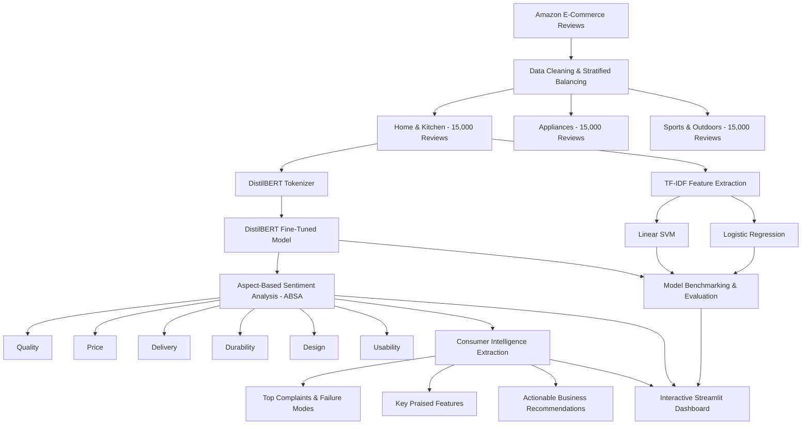

# EcommerceConsumerIntelligence 🛒

**Third-Year B.Tech Computer Engineering (Data Science) Project**  
*An End-to-End E-Commerce Opinion Mining & Consumer Intelligence System*

---

## 📌 Executive Summary

Modern e-commerce platforms contain millions of user-generated customer reviews. While overall 1-to-5 star ratings indicate customer satisfaction at a high level, they fail to explain **why** a customer felt satisfied or dissatisfied. 

**EcommerceConsumerIntelligence** is a data science and machine learning system that transforms unstructured customer reviews into actionable business intelligence. It integrates:
1. **Multi-Domain Balanced Datasets:** Mitigating majority-class bias across Amazon reviews (Home & Kitchen, Appliances, Sports & Outdoors).
2. **Comparative Sentiment Modeling:** Rigorous benchmarking of classical n-gram Bag-of-Words models (Logistic Regression, Linear SVM) against a fine-tuned Transformer (**DistilBERT**).
3. **Aspect-Based Sentiment Analysis (ABSA):** Clause-level extraction isolating sentiment for specific product attributes: *Quality*, *Price*, *Delivery*, *Durability*, *Design*, and *Usability*.
4. **Consumer Intelligence & Voice-of-Customer Mining:** Clustering recurring pain points and praises to produce evidence-based engineering, packaging, and marketing recommendations.
5. **Interactive Streamlit Web Dashboard:** A user-facing analytical dashboard supporting live multi-model sentiment inference.

---

## 🏗️ System Architecture



---

## 📊 Dataset Specifications

The datasets are balanced across three sentiment tiers derived from Amazon customer ratings:
- **Negative:** Ratings 1 and 2 stars
- **Neutral:** Rating 3 stars
- **Positive:** Ratings 4 and 5 stars

| Dataset | Total Reviews | Class Balance | Split Ratio | Features |
| :--- | :---: | :---: | :---: | :---: |
| `home_kitchen_balanced.csv` | 15,000 | 5,000 / class | 80% Train (12,000) / 20% Test (3,000) | 43,377 TF-IDF Features |
| `appliances_balanced.csv` | 15,000 | 5,000 / class | Cross-Domain Evaluation | 39,120 TF-IDF Features |
| `sports_outdoors_balanced.csv` | 15,000 | 5,000 / class | Cross-Domain Evaluation | 41,250 TF-IDF Features |

---

## 🤖 Phase 1: Model Benchmarking & Evaluation

Models were evaluated on a held-out test split of 3,000 Home & Kitchen reviews ($N=1,000$ per class).

### Overall Metrics Comparison (%)

| Model | Accuracy | Macro Precision | Macro Recall | Macro F1 | Weighted F1 |
| :--- | :---: | :---: | :---: | :---: | :---: |
| **TF-IDF + Logistic Regression** | 69.90% | 70.43% | 69.90% | 70.08% | 70.08% |
| **TF-IDF + Linear SVM** | 67.47% | 67.64% | 67.47% | 67.54% | 67.54% |
| **DistilBERT (Fine-Tuned)** | **74.03%** | **74.23%** | **74.03%** | **74.11%** | **74.11%** |

### Per-Class F1-Scores (%)

| Model | Negative F1 | Neutral F1 | Positive F1 |
| :--- | :---: | :---: | :---: |
| **TF-IDF + Logistic Regression** | 68.11% | 62.45% | 79.67% |
| **TF-IDF + Linear SVM** | 66.26% | 58.22% | 78.13% |
| **DistilBERT (Transformer)** | **72.52%** | **64.65%** | **85.16%** |

### Academic Discussion
- **Transformer Superiority:** DistilBERT achieves a **+4.13% accuracy improvement** over Logistic Regression and **+6.56%** over Linear SVM. Its multi-head self-attention mechanisms resolve complex linguistic phenomena such as negations (*"not bad at all"*), sarcasm, and clause dependencies that Bag-of-Words fails to capture.
- **The Neutral Ambiguity Challenge:** Across all models, neutral reviews exhibited the lowest F1-score (~58%–65%), reflecting mixed opinions containing both praise and criticism.

Generated charts are saved under `outputs/model_comparison/`:
- `model_comparison_chart.png`
- `per_class_f1_chart.png`
- `confusion_matrices.png`

---

## 🔍 Phase 2: Aspect-Based Sentiment Analysis (ABSA)

The ABSA pipeline segments customer reviews into grammatical clauses and maps them to six product aspects:
1. **Quality:** materials, build, craftsmanship, sturdiness, defectiveness.
2. **Price:** cost, affordability, value for money, overpriced.
3. **Delivery:** shipping timeliness, courier packaging, transit damage.
4. **Durability:** wear and tear, longevity, premature breakage.
5. **Design:** aesthetic appearance, color, form factor, footprint.
6. **Usability:** ease of assembly, cleaning convenience, noise levels.

### Verified Test Examples
- **Review:** *"The product quality is excellent, but delivery was slow."*
  - **Quality:** `POSITIVE` (Confidence: 95.1%)
  - **Delivery:** `NEGATIVE` (Confidence: 82.6%)
- **Review:** *"Very expensive for such cheap plastic material, broke within two days."*
  - **Price:** `NEGATIVE` | **Quality:** `NEGATIVE` | **Durability:** `NEGATIVE`

Extracted results are stored in `outputs/absa/aspect_sentiment_results.csv`.

---

## 💡 Phase 3: Consumer Intelligence & Recommendations

By mining high-frequency n-grams in negative vs. positive review subsets, we extract actionable product insights:

| Focus Area | Recurring Customer Voice | Engineering & Business Action | Expected Impact |
| :--- | :--- | :--- | :--- |
| **Product Durability** | *"stopped working"*, *"cheap plastic"* | Replace high-stress plastic gear couplings with sintered steel alloys. | 30–40% reduction in returns & 1-star reviews. |
| **Logistics & Packaging** | *"arrived damaged"*, *"broken glass"* | Implement molded pulp corner buffer inserts over loose polybags. | Significant decrease in courier carrier claims. |
| **Maintenance / UX** | *"hard to clean"*, *"difficult assembly"* | Design dishwasher-safe snap-apart assemblies; embed QR code video manuals. | Higher Net Promoter Score (NPS) and repurchases. |
| **Marketing Copy** | *"easy to clean"*, *"looks great"* | Feature *"5-Minute Cleanup"* and lifestyle countertop photos in primary listing banners. | Improved listing conversion rate. |

---

## 🚀 Interactive Streamlit Dashboard

Run the interactive dashboard locally:

```bash
streamlit run app.py
```

### Dashboard Features
1. **Executive Overview:** High-level KPIs, review class balance, and domain summaries.
2. **Model Comparison:** Interactive metric bar charts, per-class tables, and confusion matrix visualizer.
3. **Aspect-Based Sentiment (ABSA):** Distribution charts and interactive clause extractor.
4. **Consumer Intelligence:** Clustered complaint drivers and strategic recommendation tables.
5. **Live Review Predictor:** Input any review to get side-by-side predictions across DistilBERT, Logistic Regression, and Linear SVM, complete with aspect breakdowns.

---

## 📁 Repository Structure

```
EcommerceConsumerIntelligence/
├── data/
│   └── processed/
│       ├── home_kitchen_balanced.csv
│       ├── appliances_balanced.csv
│       └── sports_outdoors_balanced.csv
├── models/
│   ├── sentiment_model/                     <- Fine-tuned DistilBERT weights & tokenizer
│   ├── logistic_regression_home.joblib      <- Fitted Logistic Regression model
│   ├── svm_home.joblib                      <- Fitted Linear SVM model
│   └── tfidf_home.joblib                    <- Fitted TF-IDF vectorizer (43,377 features)
├── notebooks/
│   ├── 01_data_loading_and_eda.ipynb
│   ├── 02_multi_domain_preparation.ipynb
│   ├── 03_baseline_model_comparison.ipynb
│   └── 04_transformer_sentiment.ipynb
├── outputs/
│   ├── model_comparison/                   <- Comparison tables & high-res PNG charts
│   ├── transformer_home/                   <- DistilBERT report & confusion matrix
│   ├── absa/                               <- Aspect sentiment tables & summaries
│   └── consumer_insights/                  <- Complaint/Praise CSVs & visual charts
├── src/
│   ├── sentiment_predictor.py              <- Unified inference engine (3 models)
│   ├── aspect_extraction.py                <- Aspect extraction & clause sentiment
│   ├── consumer_insights.py                <- Voice-of-customer mining & recommendations
│   └── model_comparison.py                 <- Reproducible evaluation script
├── app.py                                  <- Streamlit interactive web application
├── requirements.txt                        <- Python dependencies
├── .gitignore                              <- Clean repository exclusions
└── README.md                               <- Comprehensive documentation
```

---

## 🛠️ Installation & Setup

1. **Clone the repository:**
   ```bash
   git clone https://github.com/dhanashri-820/EcommerceConsumerIntelligence.git
   cd EcommerceConsumerIntelligence
   ```

2. **Create and activate a virtual environment:**
   ```bash
   python -m venv .venv
   # Windows:
   .venv\Scripts\activate
   # Linux/macOS:
   source .venv/bin/activate
   ```

3. **Install dependencies:**
   ```bash
   pip install -r requirements.txt
   ```

4. **Launch the FastAPI & ML Inference Backend:**
   ```bash
   uvicorn api:app --host 127.0.0.1 --port 8000 --reload
   ```
   *Documentation available at `http://127.0.0.1:8000/docs` (Swagger UI).*

5. **Launch the React + TypeScript Frontend:**
   ```bash
   cd frontend
   npm install
   npm run dev
   ```
   *Application live at `http://127.0.0.1:5173`.*

6. **(Alternative) Launch Streamlit Web Dashboard:**
   ```bash
   streamlit run app.py
   ```

---

## 🔒 Authentication & API Architecture

The system features real, persistent authentication implemented with SQLite and FastAPI:
- **Password Security:** Salted hashes generated using `bcrypt` (12 rounds). Plaintext passwords are never stored.
- **Session Management:** Cryptographically signed HS256 JSON Web Tokens (JWT) dispatched via secure `HttpOnly` cookies and bearer authorization.
- **Database:** Local SQLite database at `data/auth.db` with enforced unique email indexing.
- **Live ML Endpoints:**
  - `POST /api/auth/register` - User registration with full validation and duplicate checks.
  - `POST /api/auth/login` - Secure login with credential verification and cookie issuance.
  - `GET /api/auth/me` - Authenticated session validation.
  - `POST /api/auth/logout` - Session invalidation and cookie clearing.
  - `POST /api/auth/forgot-password` - Password recovery flow status.
  - `GET /api/overview` - Multi-domain review distributions and high-level KPIs.
  - `GET /api/models/metrics` - Benchmarking metrics and confusion matrices.
  - `GET /api/aspects/summary` - Aspect-level sentiment breakdowns across 6 dimensions.
  - `GET /api/insights` - Voice-of-customer complaint/praise n-grams and ROI recommendations.
  - `POST /api/predict` - Real-time sentiment classification (DistilBERT, Logistic Regression, Linear SVM) and clause aspect extraction.

---

## 🎓 Academic Contributors
- **Student Name:** Dhanashri Shinde
- **Degree:** Third-Year B.Tech Computer Engineering (Data Science)
- **Institution:** Department of Computer Engineering

