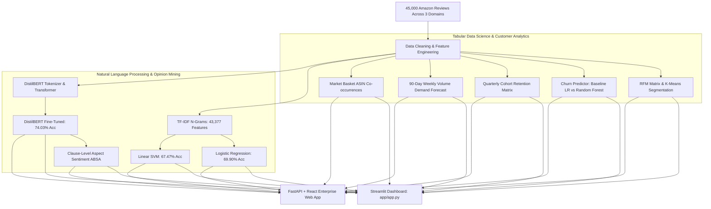

# EcommerceConsumerIntelligence 📊

> **An End-to-End E-Commerce Customer Analytics, Churn Prediction & NLP Opinion Mining Platform**  
> *Portfolio-ready Data Science & Machine Learning system combining tabular customer analytics with transformer sentiment benchmarking.*

[](LICENSE)
[](https://python.org)
[](https://fastapi.tiangolo.com/)
[](https://react.dev/)
[](https://streamlit.io/)

---

## 📌 Executive Summary & Business Problem

In high-volume e-commerce marketplaces, aggregate 1-to-5 star ratings obscure **why** buyers churn or remain loyal. Furthermore, business and product teams require answers to operational questions:
- *Which customer segments generate recurring value, and which are at imminent risk of inactivity?*
- *What specific product dimensions (Quality, Price, Delivery, Durability) drive negative reviews?*
- *How accurately can self-attention transformer models (DistilBERT) resolve complex linguistic patterns compared to linear Bag-of-Words baselines?*

**EcommerceConsumerIntelligence** is a comprehensive Data Science system integrating:
1. **RFM & K-Means Customer Segmentation:** Identifying high-value advocates vs. dormant churn risks.
2. **Predictive Churn Modeling:** Baseline Logistic Regression vs. Enhanced Random Forest with feature importances.
3. **Cohort Retention Heatmaps:** Tracking activity persistence across quarterly customer cohorts.
4. **Demand & Review Volume Time-Series Forecasting:** 90-day Holt's linear trend forecasting with 95% confidence intervals.
5. **Market Basket Co-Occurrence Mining:** Uncovering cross-reviewed item associations.
6. **Multi-Model NLP Benchmarking & ABSA:** Clause-level Aspect-Based Sentiment Analysis and DistilBERT vs. TF-IDF + LR/SVM comparison.
7. **Dual-Application Frontends:** An interactive Streamlit analytical dashboard (`app/app.py`) and an enterprise React + FastAPI dashboard.

---

## 🏗️ System Architecture



---

## 📊 Dataset & Domain Specifications

The system is trained and evaluated across 45,000 balanced Amazon customer reviews spanning three primary categories:

| Domain | Reviews | Class Distribution | Unique Users | Unique ASINs | Time Horizon |
| :--- | :---: | :---: | :---: | :---: | :---: |
| **Home & Kitchen** (Primary) | 15,000 | 1:1:1 (5,000 Neg / 5,000 Neu / 5,000 Pos) | 2,657 | 14,329 | 2003 – 2023 |
| **Appliances** (Cross-Domain) | 15,000 | 1:1:1 (5,000 Neg / 5,000 Neu / 5,000 Pos) | 14,908 | 8,020 | 2005 – 2023 |
| **Sports & Outdoors** (Cross-Domain) | 15,000 | 1:1:1 (5,000 Neg / 5,000 Neu / 5,000 Pos) | 6,073 | 13,658 | 2001 – 2023 |

---

## 📈 Key Empirical Results & Model Benchmarks

### 1. NLP Sentiment Classification Benchmarking (Held-out Test $N=3,000$)

| Model | Accuracy | Macro Precision | Macro Recall | Macro F1 | Weighted F1 |
| :--- | :---: | :---: | :---: | :---: | :---: |
| **TF-IDF + Linear SVM** | 67.47% | 67.64% | 67.47% | 67.54% | 67.54% |
| **TF-IDF + Logistic Regression** | 69.90% | 70.43% | 69.90% | 70.08% | 70.08% |
| **DistilBERT (Transformer)** | **74.03%** | **74.23%** | **74.03%** | **74.11%** | **74.11%** |

*Takeaway:* DistilBERT achieves a **+4.13% accuracy improvement** over the best linear baseline by resolving complex linguistic dependencies, sarcasm, and adversative conjunctions (*"looks nice, but broke immediately"*).

### 2. Predictive Churn Classification

| Model | Accuracy | ROC-AUC | F1-Score | 5-Fold CV ROC-AUC |
| :--- | :---: | :---: | :---: | :---: |
| **Baseline (Logistic Regression)** | 67.85% | 0.7068 | 0.6198 | 0.6980 |
| **Enhanced (Random Forest)** | **68.61%** | **0.7130** | **0.6214** | **0.7052** |

*Top Churn Predictors:* Customer Review Velocity, Tenure Length, and Average Rating Skew.

---

## 📂 Repository Structure

```
EcommerceConsumerIntelligence/
├── data/
│   ├── raw/                             <- Raw uncompressed dataset drop
│   └── processed/                       <- 45,000 balanced multi-domain CSVs
│       ├── home_kitchen_balanced.csv
│       ├── appliances_balanced.csv
│       └── sports_outdoors_balanced.csv
├── notebooks/
│   ├── 01_data_loading_and_eda.ipynb
│   ├── 02_multi_domain_preparation.ipynb
│   ├── 03_baseline_model_comparison.ipynb
│   └── 04_transformer_sentiment.ipynb
├── src/                                 <- Modular, production-tested Python source
│   ├── data_processing.py               <- Cleaning & timestamp parsing
│   ├── customer_analytics.py            <- RFM, K-Means, Cohorts, Market Basket
│   ├── churn_model.py                   <- Feature engineering & Churn ML
│   ├── forecasting.py                   <- Time-series demand forecasting
│   ├── sentiment_predictor.py           <- Multi-model inference engine
│   ├── aspect_extraction.py             <- Clause-level ABSA engine
│   └── consumer_insights.py             <- Voice-of-customer n-gram mining
├── reports/
│   └── figures/                         <- High-resolution saved evaluation plots
│       ├── customer_segments_rfm.png
│       ├── cohort_retention_heatmap.png
│       ├── churn_evaluation_and_importance.png
│       └── demand_forecast_90days.png
├── app/
│   └── app.py                           <- Streamlit Analytics & ML Dashboard
├── frontend/                            <- Enterprise React 18 + Vite Web App
├── tests/
│   └── test_data_processing.py          <- Automated unit tests
├── models/                              <- Fitted models (DistilBERT, TF-IDF, SVM, LR)
├── api.py                               <- FastAPI backend with SQLite JWT auth
├── run_pipeline.py                      <- Single-command full pipeline execution
├── requirements.txt                     <- Pinned project dependencies
├── LICENSE                              <- MIT License
└── README.md
```

---

## ⚡ Quickstart & Installation

### 1. Clone & Set Up Environment

```bash
git clone https://github.com/dhanashri-820/EcommerceConsumerIntelligence.git
cd EcommerceConsumerIntelligence

# Create and activate virtual environment
python -m venv .venv
# On Windows:
.venv\Scripts\activate
# On Linux/macOS:
source .venv/bin/activate

# Install dependencies
pip install -r requirements.txt
```

### 2. Run the Full Analytics Pipeline

Execute data ingestion, cleaning, RFM segmentation, churn modeling, and time-series forecasting in a single command:
```bash
python run_pipeline.py
```

### 3. Run Automated Tests

```bash
python -m unittest tests/test_data_processing.py
```

### 4. Launch the Applications

- **Streamlit Analytics Dashboard:**
  ```bash
  streamlit run app/app.py
  ```
- **FastAPI Backend (with Swagger UI):**
  ```bash
  uvicorn api:app --host 127.0.0.1 --port 8000
  ```
- **React Modern Frontend:**
  ```bash
  cd frontend
  npm install
  npm run dev
  ```

---

## 👤 Author & Academic Details

- **Author:** Dhanashri Shinde
- **Degree:** Third-Year B.Tech Computer Engineering (Data Science)
- **Repository:** [https://github.com/dhanashri-820/EcommerceConsumerIntelligence](https://github.com/dhanashri-820/EcommerceConsumerIntelligence)
- **License:** MIT License
